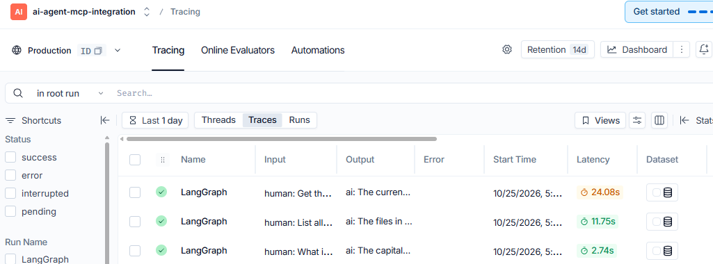

# MCP Assessment Agent

A demonstration of an AI agent that can decide when to use external tools, execute them through the [Model Context Protocol (MCP)](https://modelcontextprotocol.io/), and report what happened. The agent uses a Google Gemini chat model, LangGraph for its reasoning/tool loop, and two stdio MCP servers: a sandboxed filesystem server and a time server.

The entrypoint runs three fixed demonstrations: answering a general-knowledge question without tools, listing files in the sandbox, and obtaining the current UTC time before writing it to a sandbox file. Per-run LLM and tool telemetry is printed in the terminal and saved to `run_reports.json`.

## Architecture

```text
main.py
  ├─ Loads .env / environment settings (agent/schemas.py)
  ├─ Creates sandbox/ and prepares MCP server configuration
  ├─ MCPManager ── starts filesystem + time MCP servers and loads tools
  ├─ build_llm ── creates Gemini chat model ── binds discovered tools
  ├─ build_agent_graph ── LangGraph agent/tool loop
  ├─ TelemetryCallbackHandler ── records LLM and tool activity
  └─ Prints scenario reports and writes run_reports.json
```

For each scenario, the graph sends the system prompt and user query to the model. If the model requests a tool, LangGraph's `ToolNode` dispatches it to the matching MCP tool, appends the result to the conversation, and calls the model again. If the model responds without a tool request, the graph finishes. The configured iteration limit prevents an unbounded tool-call loop.

The filesystem MCP server is given the resolved sandbox directory as its allowed root. The prompt directs the model to use paths relative to that root. The time MCP server is configured for UTC. On Windows, the filesystem server is launched through `cmd.exe` to invoke the npm command shim, and the time server through `uvx.exe`; other platforms use `npx` and `uvx`.

## Requirements

- Python and pip
- Node.js/npm, providing `npx`, for `@modelcontextprotocol/server-filesystem`
- Astral `uv`, providing `uvx`, for `mcp-server-time`
- A Google AI API key for the Gemini model
- Internet access for the model API and MCP server package startup

The MCP servers are launched as subprocesses by the application. They are not Python services and are not started separately.

## Setup

From the project root, create and activate a virtual environment, then install the Python packages:

```powershell
python -m venv .venv
.\.venv\Scripts\Activate.ps1
python -m pip install -r requirements.txt
```

On macOS/Linux, activate with:

```sh
source .venv/bin/activate
```

Create a `.env` file in the project root with the required API key and any desired overrides:

```dotenv
GOOGLE_API_KEY=your_google_ai_api_key

# Optional settings (defaults shown)
MODEL_NAME=gemini-3.1-flash-lite
TEMPERATURE=0.1
MAX_TOKENS=1024
MAX_ITERATIONS=5
MCP_SANDBOX_PATH=./sandbox

# Optional LangSmith tracing
LANGSMITH_TRACING=false
LANGSMITH_API_KEY=
LANGSMITH_PROJECT=mcp-agent-assessment
```

Do not commit `.env` or put real API keys in source control. `.gitignore` excludes environment files. `GOOGLE_API_KEY` is required; the other settings have defaults. Environment variables take precedence over values from `.env`.

`rich` is imported for terminal output by `main.py` and `agent/telemetry.py`, but is not explicitly listed in the current `requirements.txt`. If it is not already installed in your environment, install it with:

```powershell
python -m pip install rich
```

## Run

From the project root, with the virtual environment active:

```powershell
python main.py
```

The program connects to the MCP servers, runs all three scenarios sequentially, displays each final answer and its telemetry, then overwrites `run_reports.json` with the combined results. It attempts to close the MCP client in a `finally` block.

### Demonstration scenarios

1. **No tool needed** — asks for the capital of France; the expected behavior is to answer directly without MCP calls.
2. **Clear tool call** — asks for the files in the sandbox root; the expected behavior is to use the filesystem MCP tool.
3. **Cross-server tool chain** — asks for the current UTC time and then to write that exact timestamp to `timestamp.txt`; the expected behavior is to use the time and filesystem MCP servers in sequence.

These are demonstration inputs, not automated assertions. Model responses and tool choices are generated at runtime.

## Configuration reference

Settings are defined by `Settings` in `agent/schemas.py` and loaded through `pydantic-settings` from `.env` and the process environment. Names are case-insensitive.

| Variable | Required | Default | Purpose |
| --- | --- | --- | --- |
| `GOOGLE_API_KEY` | Yes | — | Credential used by the Google Gemini integration. |
| `MODEL_NAME` | No | `gemini-3.1-flash-lite` | Gemini model identifier. |
| `TEMPERATURE` | No | `0.1` | Model sampling temperature; validated from 0 through 2. |
| `MAX_TOKENS` | No | `1024` | Maximum output tokens configured for the model; must be positive. |
| `MAX_ITERATIONS` | No | `5` | Maximum number of assistant turns that request tools in one graph run; must be positive. |
| `MCP_SANDBOX_PATH` | No | `./sandbox` | Directory exposed as the filesystem MCP server's allowed root. |
| `LANGSMITH_TRACING` | No | `false` | Enables LangSmith tracing only when set to true and an API key is also supplied. |
| `LANGSMITH_API_KEY` | No | — | LangSmith credential; only used when tracing is enabled. |
| `LANGSMITH_PROJECT` | No | `mcp-agent-assessment` | LangSmith project name when tracing is enabled. |

LangSmith tracing is optional and separate from the local callback telemetry printed and saved by the application.

## Telemetry and output

`TelemetryCallbackHandler` records each LLM call's model name, token counts, and duration, along with each tool call's name, server, input, output, error status, and duration. Tool output is truncated for storage after 1,000 characters; displayed tool input/output is shortened further for terminal tables. A `RunReport` aggregates the per-call records and total token counts and wall-clock duration.

Each entry in `run_reports.json` contains:

- `scenario`: the scenario id, name, description, and query
- `report`: final response, individual LLM calls, individual tool calls, aggregate token counts, and total duration

The file is a generated run artifact and is overwritten each time `main.py` completes the scenario loop. An execution error within a scenario is displayed and recorded as an error response; the runner continues to later scenarios.

## Project files

| Path | Purpose |
| --- | --- |
| `main.py` | Entrypoint and integration layer. Loads settings, prepares the sandbox and MCP server configs, builds the model and graph, runs the scenarios, prints telemetry, writes the report JSON, and closes the MCP client. |
| `agent/__init__.py` | Empty package marker for the `agent` Python package. |
| `agent/schemas.py` | Pydantic settings, MCP server configuration, per-call telemetry records, and aggregate run-report schema. |
| `agent/llm.py` | Factory for the configured Gemini `ChatGoogleGenerativeAI` client. |
| `agent/mcp_manager.py` | Connects to configured MCP servers, discovers tools, tracks tool-to-server attribution, and attempts client cleanup. |
| `agent/graph.py` | Defines and compiles the LangGraph state machine for model calls, tool execution, iteration limiting, and final responses. |
| `agent/prompts.py` | System prompt with tool-selection, sequencing, and sandbox-relative path instructions. |
| `agent/telemetry.py` | LangChain callback handler and Rich terminal rendering for LLM/tool telemetry and run totals. |
| `requirements.txt` | Python package dependency ranges. |
| `sandbox/notes.md` | Sample Markdown content created by `ensure_sandbox()` for the filesystem demonstration. |
| `sandbox/sample.txt` | Sample text content created by `ensure_sandbox()` for the filesystem demonstration. |
| `sandbox/timestamp.txt` | Timestamp output created by the third scenario; the startup helper does not reset this file. |
| `run_reports.json` | Generated report from a previous run; replaced by the next run. |
| `.env` | Local, untracked environment configuration. Create it as described above; do not commit credentials. |
| `.gitignore` | Excludes virtual environments, Python build/cache artifacts, environment files, and IDE/OS files. |
| `.venv/` | Local virtual environment, if present. Generated dependency files are not application source and are ignored by Git. |

`ensure_sandbox()` creates the sandbox directory if necessary and rewrites `notes.md` and `sample.txt` on each start. The third scenario may create or update `timestamp.txt`.

## Troubleshooting

- **Settings validation fails:** ensure `GOOGLE_API_KEY` is set in the project-root `.env` or process environment.
- **MCP server startup fails:** verify `npx` and `uvx` are installed and available on `PATH`; check network access and the startup diagnostics printed for the server.
- **`rich` import fails:** install it in the active environment with `python -m pip install rich`.
- **Filesystem tool cannot see a file:** check `MCP_SANDBOX_PATH`; the filesystem server is intentionally restricted to that directory.
- **Tracing is absent:** local telemetry still works independently; LangSmith tracing requires both `LANGSMITH_TRACING=true` and `LANGSMITH_API_KEY`.


## Assumptions
MCP Server Availability: The solution assumes that the configured public MCP servers are accessible and their required dependencies are installed.

Model Access: A valid Google Gemini API key and internet connectivity are required for LLM inference.


## Limitations
Tool Selection: Tool selection is LLM-driven and may vary based on query phrasing and model behavior.

Execution Boundaries: A configurable iteration limit is applied to prevent excessive tool execution and maintain predictable resource usage.

Logging: Tool inputs and outputs are truncated in execution logs to keep reports concise and manageable.


## LangSmith Observability
